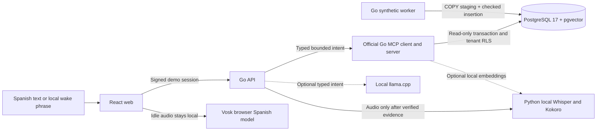

# Data Mind 2 architecture

The owner approved the Go split on 2026-10-22. The supported runtime is **Go for API, MCP, PostgreSQL access and ingestion; Python only for voice/model inference; React/TypeScript for the Spanish interface**. Earlier Python backend code is archived for traceability, not launched.

## Five applications

- apps/web: Spanish UI, explicit microphone consent, local wake recognition, bounded PCM recording, stop/cancel, evidence tables and feedback.
- apps/api: signed, expiring synthetic demo sessions, turn ownership, bounded orchestration, persistent turns/feedback and authenticated voice proxy.
- apps/mcp: seven read-only domain tools over real MCP Streamable HTTP. No arbitrary SQL, shell or filesystem tools.
- apps/worker: deterministic synthetic generation, batched loading/checkpoints, idempotent daily append, independent manifests and verification.
- apps/voice: authenticated local STT/TTS/model inference. Models are explicitly downloaded and hash checked; inference does not silently download files.

## Safety boundary

The application chooses tenant identity from its signed session; model text cannot choose the tenant. API-to-MCP authentication is internal and the tool scope must match the tenant header. The database adds forced RLS, an explicit tenant predicate, a restricted login and a read-only repeatable-read transaction. Counts, rows and provenance therefore share one snapshot. Query limits do not change aggregate totals. Date ranges are half-open local calendar boundaries converted to UTC.

Demo sessions intentionally allow choosing among five **fictional** tenants only when DEMO_MODE=true. This is not enterprise identity authentication. Before real data: replace demo sessions with reviewed OIDC, authorization, secure deployment and retention policies. Do not expose this demonstration to the internet.

Evidence includes query ID, dataset version, effective scope, query time, event watermark, full matching count, returned count, truncation, sources and warnings. Numeric answer templates use validated evidence. A clarification is not a factual answer and is never sent to TTS. Retrieval passages are untrusted data, never runtime instructions.

## Honest voice boundary

Say “Hola asistente”, pause until the UI listens, then ask. The browser must remain active and microphone permission must be granted. This is bounded utterance HTTP transport, not WebRTC/Pipecat streaming or tested voice barge-in. Stop cancels browser playback and ignores stale responses; compute already running may continue until its service deadline. A prepared local acknowledgement is separate from a factual answer.

## Learning boundary

Feedback is explicit and attached to an owned turn/evidence. It does not rewrite code or prompts, trigger fine-tuning, or train on private information. Improvements require curated synthetic cases, a versioned candidate, evaluation gates, review and rollback. See the controlled-improvement runbook.
